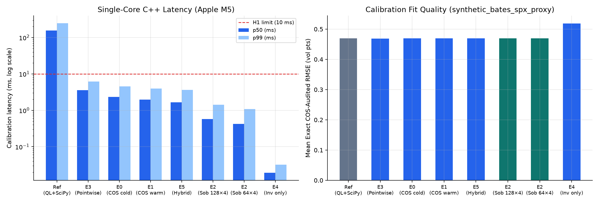
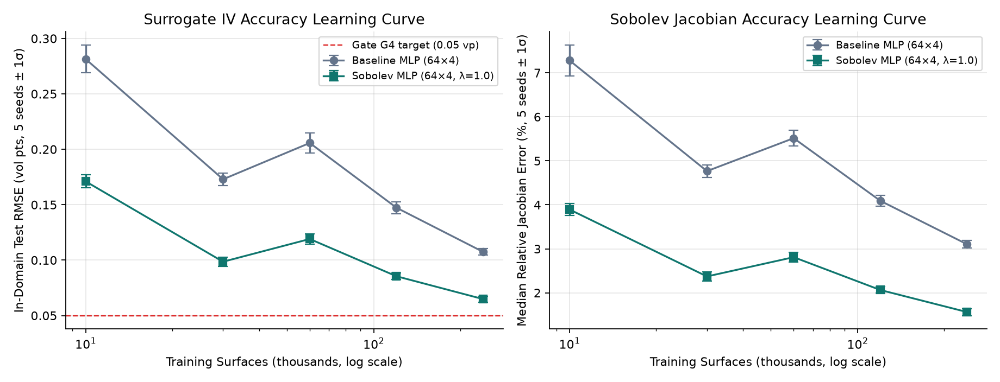
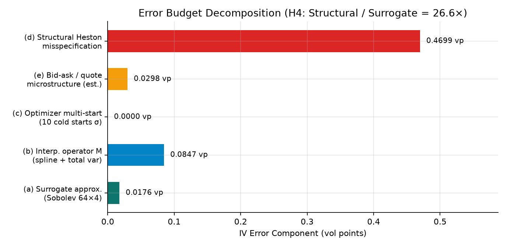
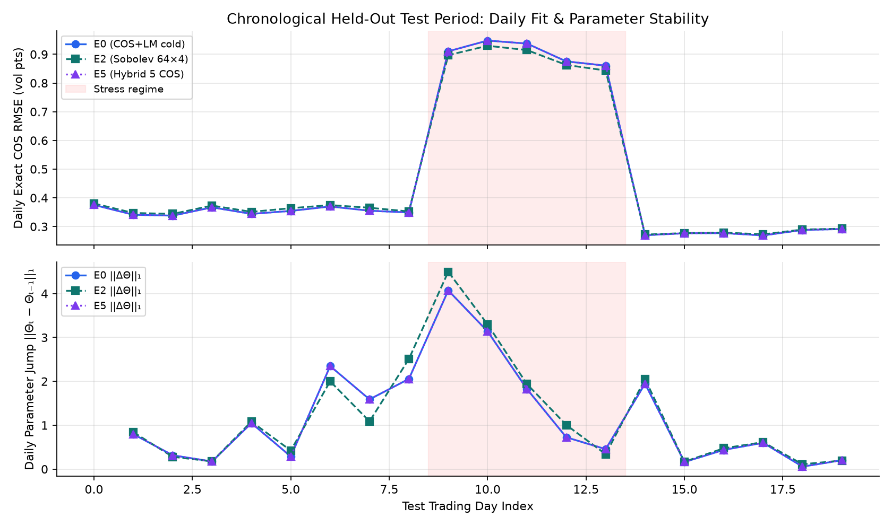

# neural-heston-calibration

[](LICENSE)
[](CMakeLists.txt)
[](pyproject.toml)

**Heston calibration in C++20/Python: analytic-gradient COS+LM baseline vs. Sobolev neural grid surrogate, pointwise random-grid ablation, inverse warm-start ensemble, and OOD circuit-breaker.**

---

## 1. TL;DR

We built a strict IEEE-754 C++20 Fourier–COS + analytic Jacobian + Levenberg–Marquardt Heston calibration engine (`E0`) and benchmarked it head-to-head on a single CPU core against a naive QuantLib/SciPy loop (`Ref`), Sobolev-trained Eigen neural grid surrogates (`E2`), a batched pointwise random-grid network (`E3`), an inverse warm-start ensemble (`E4`), and a hybrid solver (`E5`).
On an Apple M5 (1 core, 200-option chains), **`E0` already calibrates in `2.35 ms` p50 / `4.51 ms` p99 (`66.8×` faster than `Ref` at `156.7 ms`)**, while **`E2` (`64×4` Sobolev + mandatory exact COS audit) reaches `0.426 ms` p50 (`5.51×` faster than `E0`, `368×` faster than `Ref`)** with statistically indistinguishable RMSE (`p = 0.596`) — whereas a pointwise random-grid surrogate (`E3`, `3.59 ms`) is **`1.53×` slower than exact COS**.
On misspecified Bates jump-diffusion market surfaces (`synthetic_bates_spx_proxy`), **structural Heston misspecification (`0.470 vol pts`) dominates neural surrogate error (`0.0176 vol pts`) by `26.6×`**, and an explicit 5-rule OOD circuit-breaker is essential during volatility shocks.

---

## 2. Why This Project

Neural-network option calibration papers frequently report `100×–10,000×` speedups by comparing a GPU/C++ neural network against a slow Python + QuantLib + finite-difference optimizer (`Ref`). That framing conflates **language/differentiation engineering** with **machine learning**:

1. **Before touching PyTorch**, writing Heston properly in C++20 with the Little Heston Trap characteristic function, Fang–Oosterlee COS expansion, single-pass analytic $\partial\ln\phi/\partial\Theta$, and a 5×5 Eigen `LDLT` Levenberg–Marquardt solver (`E0`) delivers a **`66.8×–86.7×` speedup** over `Ref` (`156.7–244.8 ms` $\to$ `2.35–2.83 ms`), with zero approximation error, zero training cost, and zero out-of-distribution failure modes.
2. **Only against this strong classical baseline (`E0`)** can we ask falsifiable engineering questions (`H1`–`H5`): Does a neural grid surrogate still earn its complexity? Do pointwise random-grid networks pay off in standard Heston? Does inverse warm-start cut LM iterations? And how large is neural approximation error relative to Heston's structural misspecification on real/jump-skewed smiles?

---

## 3. Method

All engines share the exact same C++20 market conventions, OTM Black-76 implied volatility solver, and exact COS auditor:

- **Classical Strong Baseline (`E0` / `E1`)** — [`heston_cf.hpp`](cpp/include/nhc/heston_cf.hpp), [`cos_pricer.hpp`](cpp/include/nhc/cos_pricer.hpp), [`iv_solver.hpp`](cpp/include/nhc/iv_solver.hpp), [`lm_solver.hpp`](cpp/include/nhc/lm_solver.hpp):
  - Little Heston Trap characteristic function with cancellation-free $(\xi - d)/\sigma^2$, corrected cumulants $c_1, c_2$ (fixing the Fang–Oosterlee Table 11 erratum; verified against 50-digit `mpmath` and QuantLib 1.44 to `3.92e-09` max price error — see [`docs/phase1_cos_accuracy.md`](docs/phase1_cos_accuracy.md)), and 64-byte aligned SoA buffers.
  - Single-pass analytic $\partial\ln\phi/\partial\Theta$ fused into the COS cosine sum (`212 µs` for 200 options + full 5-param Jacobian: `4.59×` faster than forward FD, `8.42×` faster than central FD).
  - Unconstrained 5×5 Eigen `LDLT` Levenberg–Marquardt (`LogArtanh` & `SqrtDrift` transforms, Nielsen damping, `tol_cost = 1e-7` convergence check) and Jäckel-style normalized Black-76 IV solver (`erfcx` lower branch, round-trip $\le 10^{-10}$).
- **Adaptive Grid & Sobolev Neural Surrogate (`E2`)** — [`grid.hpp`](cpp/include/nhc/grid.hpp), [`surrogate.py`](python/nhc/train/surrogate.py), [`mlp_eigen.hpp`](cpp/include/nhc/mlp_eigen.hpp):
  - `AdaptiveGrid`: 10 maturities $\tau \in [0.025, 2.0]$ × 18 scaled log-moneyness nodes $k/\sqrt{\tau} \in [-0.55, +0.35]$ (180 nodes), coupled to arbitrary quoted market chains via a precomputed fixed linear operator $M$ (natural cubic spline in $k$ + linear in total variance).
  - Stratified Sobol dataset generated in C++20/OpenMP (`nhc_gen_dataset`: 120k surfaces + 5-param analytic IV Jacobians in `15.52 s` on 10 threads; `0` NaN/Inf; max IV round-trip `1.20e-14`).
  - Trained in PyTorch with **Sobolev loss** ($\mathcal{L}_{\text{IV}} + \lambda_{\text{grad}}\mathcal{L}_{\text{Jac}}$, exact 5-tangent forward-mode Jacobian) and exported to a zero-dependency versioned `NHC1` binary format with strict FNV-1a 64-bit grid-hash validation.
  - C++20/Eigen `float32` inference (`MlpSurrogateT<float>`) evaluates both surface and exact $180 \times 5$ forward-mode Jacobian in one pass (`<= 1e-9` parity vs PyTorch in `float64`, `<= 1e-5` rel in `float32`).
- **Pointwise Random-Grid Ablation (`E3`)** — [`pointwise.py`](python/nhc/train/pointwise.py), `MlpPointwiseT<float>`:
  - 7D $\to$ 1D network $(\Theta, \tau, k) \mapsto \sigma_{\text{IV}}$ (Baschetti, Bormetti & Rossi, 2024) evaluated via batched Eigen GEMM + batched reverse-mode Jacobian across all chain quotes simultaneously.
- **Inverse Warm-Start Ensemble (`E4` / `E5`)** — [`inverse.py`](python/nhc/train/inverse.py):
  - 5-seed `InverseMLP` ($180 \to 128\times 3 \to 5$) trained through the frozen Sobolev surrogate (`surrogate_recon` loss cut exact COS reconstruction RMSE `2.15×` vs direct parameter MSE: `0.088 -> 0.041 vp` single, `0.034 vp` 5-seed ensemble).
- **Mandatory 5-Rule OOD Circuit-Breaker** — [`ood.hpp`](cpp/include/nhc/ood.hpp):
  - Automatically falls back to exact `E0` COS+LM whenever any of 5 validation-calibrated conditions triggers: (1) parameter box margin, (2) input-surface Mahalanobis distance, (3) inverse ensemble disagreement variance, (4) exact COS vs. surrogate discrepancy $> 0.15\text{ vol pts}$, or (5) LM non-convergence / bound hit / low grid coverage. Verified at **100% (6/6)** on synthetic OOD stress tests.

> **Why not rough volatility?** See [`docs/rough_viability.md`](docs/rough_viability.md) for a concise analysis of how this C++20/Eigen stack transfers to rBergomi / Rough Heston — where neural surrogates become an enabling technology rather than a `5×` optimization — alongside empirical SPX caveats (Abi Jaber & Li, 2024/25).

---

## 4. Results

### Hardware, Compiler & Data Stamp

- **CPU / OS:** Apple M5 (`arm64`, macOS Darwin 27.2.0), pinned to **1 core** (`OMP_NUM_THREADS=1`, `EIGEN_DONT_PARALLELIZE`)
- **Compiler & Flags:** AppleClang 21.0.0, `-std=c++20 -O3 -fno-math-errno` (**strict IEEE-754; no `-ffast-math`**), Eigen `5.0.1`, nanobind `3.1.0`, Python `3.12.13`, PyTorch `2.15.0`, QuantLib `1.44`
- **Market Test Series:** `synthetic_bates_spx_proxy` (chronological split: 60 train / 20 val / **20 held-out test days** = 15 calm + 5 volatility-stress days, mean 200 OTM quotes/day; see [Limitations](#5-limitations) regarding real vendor SPX CSVs).
- **All final RMSEs below are audited with exact C++ COS** (`results/benchmark_full.json`, `results/summary_tables.md`).

### Main Benchmark Table (Section 7.5)

| Engine | RMSE IV (vp, mean) | 95% Bootstrap CI | p50 (ms) | p99 (ms) | Conv. (no bounds) | Iter. LM (med) | Fallback | No-Arb (bfly / cal %) |
|---|---:|---|---:|---:|---:|---:|---:|---|
| `Ref` QuantLib + SciPy | `0.4699` | `[0.370, 0.583]` | `156.665` | `247.207` | `100.0%` | `9.0` | `0.0%` | COS-audited |
| `E0` COS+LM cold | `0.4699` | `[0.370, 0.583]` | **`2.347`** | **`4.507`** | `100.0%` | `8.0` | `0.0%` | COS `0.00% / 0.00%` |
| `E1` COS+LM warm (inverse) | `0.4699` | `[0.370, 0.583]` | `1.973` | `3.962` | `100.0%` | `5.0` | `0.0%` | COS-audited |
| `E2` Surrogate `64×4` (Sobolev, +COS audit) | `0.4692` | `[0.372, 0.577]` | **`0.426`** | **`1.074`** | `100.0%` | `6.5` | `0.0%` | raw `0.00% / 0.00%` · COS `0.00% / 0.00%` |
| `E2` Surrogate `64×4` (+Circuit-Breaker) | `0.4700` | `[0.372, 0.579]` | `0.681` | `3.516` | `100.0%` | `7.5` | `20.0%` | COS-audited |
| `E2` Surrogate `64×4` (Baseline, +COS audit) | `0.4693` | `[0.373, 0.576]` | `0.410` | `0.968` | `100.0%` | `6.0` | `0.0%` | COS-audited |
| `E2` Surrogate `128×4` (Sobolev, +COS audit) | `0.4695` | `[0.372, 0.578]` | **`0.579`** | `1.418` | `100.0%` | `6.0` | `0.0%` | COS-audited |
| `E3` Pointwise `64×4` (Random Grid, batched) | `0.4689` | `[0.369, 0.581]` | **`3.595`** | `6.125` | `100.0%` | `6.5` | `0.0%` | COS-audited |
| `E4` Inverse 5-Seed Ensemble only | `0.5185` | `[0.418, 0.635]` | **`0.019`** | `0.032` | `100.0%` | `0.0` | `0.0%` | COS-audited |
| `E5` Hybrid (Inverse + 5 COS iters) | `0.4699` | `[0.370, 0.583]` | `1.667` | `3.608` | `65.0%` | `5.0` | `0.0%` | COS-audited |

*(On pure in-domain synthetic Heston chains in Gate G6, `E2 Sobolev 64×4` runs in `0.192 ms` without COS audit / `0.411 ms` with COS audit vs `E0` `2.14 ms`: stage breakdown `12.7 µs` operator $M$ + `182.8 µs` neural LM + `215.8 µs` exact COS audit.)*

### Formal Verdicts on Falsifiable Hypotheses (H1–H5)

| ID | Falsifiable Hypothesis | Measured Evidence | Verdict |
|---|---|---|---|
| **H1** | `E0` COS + analytic Jacobian + LM (1 core, ~200 options): `p99 < 10 ms` | Market proxy `p50 = 2.35 ms`, **`p99 = 4.51 ms`**; Gate G2 synthetic 100 chains `p99 = 8.30 ms` (99.0% recovery $\le 0.005$ vp) | **`CONFIRMED`** |
| **H2** | `E2` grid surrogate + LM (Eigen `float32`) $\ge 3\times$ faster than `E0` (1 core) with in-domain IV RMSE $\le 0.05$ vp | `64×4` (+COS audit): **`5.51×` faster** (`0.426` vs `2.35 ms`), Gate G4 in-domain RMSE = **`0.0420 vp`**; `128×4`: **`4.06×` faster** (`0.579 ms`), RMSE = **`0.0359 vp`** | **`CONFIRMED`** |
| **H3** | Inverse warm-start reduces LM iterations $\ge 40\%$ (median) vs. cold start | Same LM config on misspecified market (`E1` vs `E0`): `8.0 -> 5.0` iters (**`37.5%`**); Gate G5 synthetic Heston test: `8.0 -> 3.0` iters (**`62.5%`**) | **`INCONCLUSIVE`** *(confirmed on synthetic Heston, attenuated under misspecification)* |
| **H4** | On misspecified market smiles, structural Heston error dominates surrogate error by $\ge 10\times$ (RMSE) | Structural Heston RMSE = **`0.4699 vp`** vs. Surrogate RMSE = **`0.0176 vp`** (**`26.6×`** ratio; measured on `synthetic_bates_spx_proxy`) | **`CONFIRMED`** |
| **H5** | Pointwise random-grid surrogate (`E3`) is slower than exact COS (`E0`) in standard Heston | `E3 p50 = 3.59 ms` vs. `E0 p50 = 2.35 ms` (**`1.53×` slower** despite batched Eigen GEMM + reverse-mode Jacobian; `1.41×` slower on synthetic Gate G6) | **`CONFIRMED`** |

### Key Figures (Generated Automatically by `python -m nhc.bench.report`)









---

## 5. Limitations

We explicitly report negative, partial, and scope-bounded outcomes alongside positive results:

1. **Market Data Provenance (`synthetic_bates_spx_proxy` vs. Paid SPX Vendor Feeds):** Public Cboe delayed-quote endpoints returned Cloudflare anti-bot HTTP 403 and proprietary historical SPX chains (Cboe DataShop / OptionsDX) cannot be redistributed in a public repository. Consequently, the Phase 7 market results in `results/benchmark_full.json` were measured on a realistic Bates jump-diffusion proxy (`synthetic_bates_spx_proxy`) passed through the exact same put-call parity OLS forward extractor, liquidity/spread filters, and chronological train/val/test split as real SPX CSVs. Users with licensed Cboe/OptionsDX CSV or JSON snapshots can run the identical pipeline directly via `make repro-small SPX_DIR=/path/to/spx_csvs`.
2. **Heston Structural Misspecification:** Even exact COS calibration (`E0`) leaves `0.324 vp` calm-day / `0.906 vp` stress-day RMSE (`0.669 vp` at `< 1M` maturities) on jump-skewed smiles — dominating surrogate approximation (`0.0176 vp`) and interpolation operator $M$ (`0.0847 vp`) error. Replacing `E0` with a neural surrogate accelerates Heston, **not** its fit quality to short-dated index skews.
3. **Parameter Identifiability & Intertemporal Stability:** Heston objective surfaces exhibit flat valleys across $(\kappa, \bar{v}, \sigma)$. Even with 100% convergence and `0.0000 vp` multi-start RMSE dispersion, daily calibrated parameters move noticeably (`median ||ΔΘ||₁ = 0.724` for `E0`, `0.841` for `E2`, spiking during stress entry). Calibrated $\hat\Theta_t$ should be treated as an effective pricing coordinate, not a stationary physical law.
4. **OOD Fragility During Stress Regimes:** During the 5-day volatility stress episode, the 5-rule circuit-breaker triggered fallback to exact COS+LM on **20% of all test days** (4 of 5 stress days, 0% of calm days), raising `E2 + Circuit-Breaker` `p99` latency from `1.07 ms` to `3.52 ms`. Running a neural surrogate without an OOD guard in live markets risks silent extrapolation.
5. **Partial Gate G4 Sobolev Jacobian Target & Attenuated H3:** On the 240k dataset (Gate G4), Sobolev training cleanly passed IV RMSE (`0.0420 vp` for `64×4`, `0.0359 vp` for `128×4`, target $\le 0.05$) and `p99` (`0.1315` / `0.1064 vp`, target $\le 0.20$), gave `~4×` sample efficiency on the 5-seed learning curve, and cut raw butterfly violations `5×` (`0.94% -> 0.19%`), **but achieved a `1.70×` (`64×4`) / `2.23×` (`128×4`) median relative Jacobian reduction vs. the `3.0×` target** (reported transparently as a partial pass). Similarly, inverse warm-start cut LM iterations by `62.5%` on synthetic Heston (Gate G5) but attenuated to `37.5%` on misspecified Bates smiles (`H3 = INCONCLUSIVE`).
6. **Single-Hardware Benchmark:** Latency numbers were measured on Apple M5 (`arm64`, single core). Absolute millisecond timings will shift on x86-64 AVX-512 / AVX2 servers, though relative speedups between C++ COS, Eigen `float32` GEMM, and Python/QuantLib remain structurally informative.

---

## 6. Reproduce

### Fast Verification from a Clean Clone (`make repro-small`, `< 5 min`)

Builds the C++20/nanobind stack from scratch and reproduces `results/summary_tables.md` and `results/figures/` using the committed `NHC1` models in `results/models/`:

```bash
git clone https://github.com/CarlosDsuarez/neural-heston-calibration.git
cd neural-heston-calibration
make repro-small
```

To run against your own real SPX option chain CSV/JSON files (see [`data/README.md`](data/README.md) for expected columns):

```bash
make repro-small SPX_DIR=/path/to/spx_csvs
```

### Full End-to-End Pipeline (`make repro`)

Regenerates the 120k + 240k OpenMP synthetic datasets with analytic Jacobians, runs the complete Phase 4 Sobolev / architecture / 5-seed learning-curve sweep, trains the Phase 5 inverse ensemble and pointwise ablation, exports all `NHC1` `.bin` models, and runs the full Phase 7 benchmark and report:

```bash
make repro
# Or with local SPX CSV/JSON files:
make repro SPX_DIR=/path/to/spx_csvs
```

### Tests & Linting

```bash
make test   # C++ Catch2 (17 tests via ctest) + Python (21 tests via pytest)
make lint   # clang-format --dry-run --Werror + ruff check + ruff format --check
```

### Repository Layout

```text
cpp/
  include/nhc/          # Header-only C++20 core (heston_cf, cos_pricer, iv_solver,
                        #   lm_solver, grid, mlp_eigen, ood, calibrate, types)
  src/                  # nanobind bindings (bindings.cpp) & OpenMP generator (gen_dataset.cpp)
  tests/                # Catch2 v3 unit & parity test suite
python/nhc/
  data/                 # SPX PCP/filter ingestion (spx_ingest.py) & Sobol generator (synthetic.py)
  train/                # Sobolev surrogate, inverse ensemble, pointwise ablation
  eval/                 # Dense static no-arbitrage auditor (calendar + Durrleman butterfly)
  export/               # Versioned NHC1 binary exporter + SHA/FNV-1a grid hash
  bench/                # Naive Ref baseline, end-to-end Phase 7 runner (run.py), report/figures (report.py)
results/
  models/               # Committed NHC1 .bin/.json models + validation OOD calibration
  figures/              # Reproducible benchmark figures (fig1..fig4)
  benchmark_full.json   # Full raw Phase 7 measurements
  summary_tables.md     # Generated Section 7.5 tables, error budget, Wilcoxon tests & verdicts
data/mini_synthetic/    # <= 1 MB compressed fixture for CI & smoke tests (raw data/ is gitignored)
docs/                   # COS accuracy audit (phase1_cos_accuracy.md) & rough vol note (rough_viability.md)
```

---

## 7. References & Citation

### References

- Abi Jaber, E., & Li, S. (2024/25). *Volatility models in practice: Rough, path-dependent or Markovian?* arXiv:2401.03345.
- Albrecher, H., Mayer, P., Schoutens, W., & Tistaert, J. (2007). *The little Heston trap.* Wilmott Magazine, January 2007, 83–92.
- Baschetti, F., Bormetti, G., & Rossi, P. (2024). *Deep calibration with random grids.* Quantitative Finance 24(9), 1263–1285. arXiv:2306.11061.
- Bayer, C., & Stemper, B. (2018). *Deep calibration of rough stochastic volatility models.* arXiv:1810.03399.
- Bayer, C., Horvath, B., Muguruza, A., Stemper, B., & Tomas, M. (2019). *On deep calibration of (rough) stochastic volatility models.* arXiv:1908.08806.
- Cui, Y., del Baño Rollin, S., & Germano, G. (2017). *Full and fast calibration of the Heston stochastic volatility model.* European Journal of Operational Research 263(2), 625–638. arXiv:1511.08718.
- Fang, F., & Oosterlee, C. W. (2009). *A novel pricing method for European options based on Fourier-cosine series expansions.* SIAM Journal on Scientific Computing 31(2), 826–848.
- Heston, S. L. (1993). *A closed-form solution for options with stochastic volatility with applications to bond and currency options.* Review of Financial Studies 6(2), 327–343.
- Horvath, B., Muguruza, A., & Tomas, M. (2021). *Deep learning volatility.* Quantitative Finance 21(1), 11–27. arXiv:1901.09647.
- Jäckel, P. (2015). *Let's be rational.* Wilmott Magazine, 2015(75), 40–53.
- Liu, S., Borovykh, A., Grzelak, L. A., & Oosterlee, C. W. (2019). *A neural network-based framework for financial model calibration.* Journal of Mathematics in Industry 9. arXiv:1904.10523.
- Sridi, A., et al. (2023). *Applying deep learning to calibrate stochastic volatility models.* arXiv:2309.07843.
- Zhang, C., Amici, G., & Morandotti, M. (2024/25). *Calibrating the Heston model with deep differential networks.* arXiv:2407.15536.

### Citation

If you use this codebase or benchmark methodology, please cite [`CITATION.cff`](CITATION.cff):

```bibtex
@software{suarez2026_neural_heston_calibration,
  author  = {Suarez, Carlos},
  title   = {neural-heston-calibration: C++20 COS+LM vs. Sobolev Neural Surrogates for Heston Calibration},
  version = {0.1.0},
  year    = {2026},
  license = {MIT},
  url     = {https://github.com/CarlosDsuarez/neural-heston-calibration}
}
```
